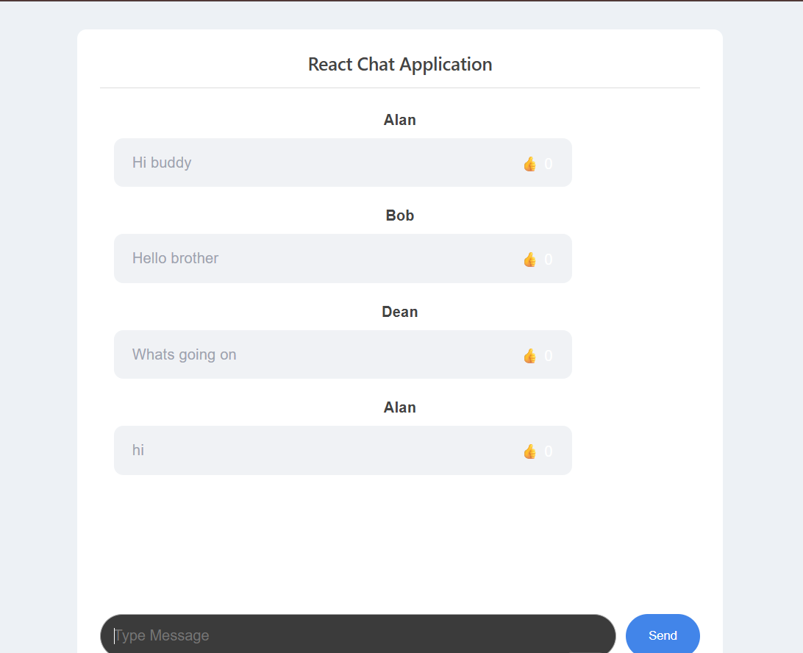

React Chat Application
Project Overview

This project is a straightforward chat application that has been made utilizing the ReactJS framework. Users can send messages and get usernames that have been randomly assigned.

Features
Messaging feature
Chat window
Random username generation
Like button to each and every message
Counting the number of likes
Sending messages using the enter key
Technologies used
Application has been built using the ReactJS
JavaScript
HTML / JSX
CSS
Vite
Installation and Configuration
Downloading and extracting the project zip file
Opening project folder in VS code
Opening the terminal.

Install the dependencies via npm install.
To run the application:

npm run dev

Use the URL in the terminal.
Note:

Messages are saved in React state and are not persistent. Refreshing the page will result in all messages being lost.

